# 📅 Randevu Sistemi

Gerçek zamanlı bir **randevu/rezervasyon uygulaması**. Müşteriler bir hizmet verenin (doktor, berber...) boş saatlerini canlı görür ve randevu alır. Hizmet verenler yeni randevuları anında bildirim olarak alır. Randevudan önce otomatik hatırlatma gönderilir.

Bu proje modern bir Node.js + React yığınının parçalarının **gerçek bir senaryoda** nasıl birlikte çalıştığını göstermek için yazıldı.

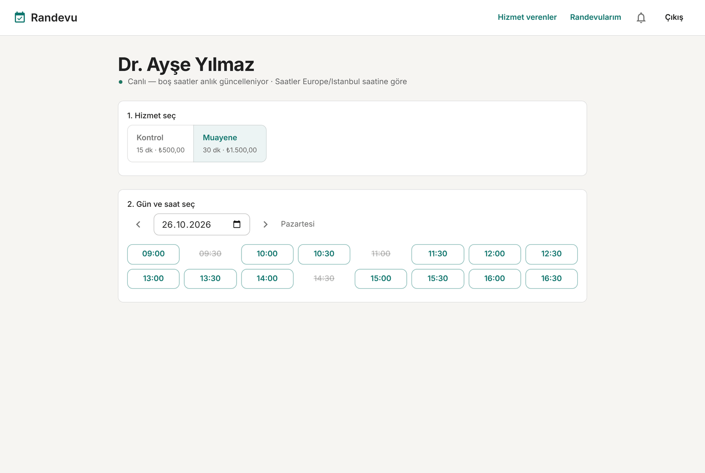

## ✨ Özellikler

- JWT ile kayıt/giriş, iki rol: **müşteri** ve **hizmet veren**
- Çalışma saatlerine göre **slot hesaplama** (zaman dilimi ve yaz saati güvenli)
- **Çifte rezervasyon koruması** (PostgreSQL advisory lock)
- **Canlı takvim**: biri slotu alınca, aynı sayfadaki herkesin ekranı anında güncellenir (WebSocket)
- **Canlı bildirimler**: onay, iptal, hatırlatma (SSE)
- **Zamanlanmış hatırlatmalar**: randevudan X dakika önce, ayrı bir worker süreciyle (BullMQ)
- Birden fazla API sürecinde çalışabilir (Redis Pub/Sub ile olay dağıtımı)

## 📸 Ekran görüntüleri

### 1. Giriş ve kayıt

| Giriş | Kayıt |
|---|---|
| 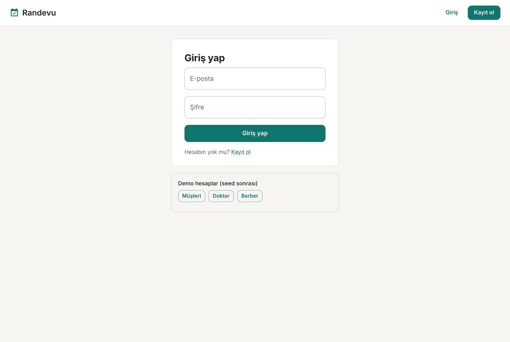 | 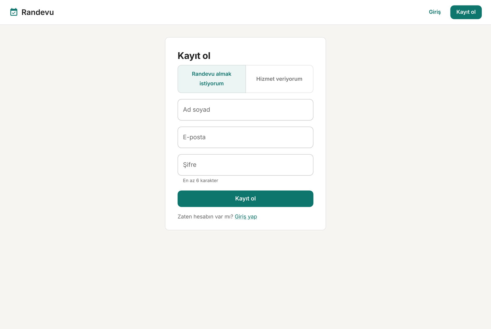 |

**Giriş:** E-posta ve şifre ile oturum açılır. Form **React Hook Form** ile yönetilir ve alanlar gönderilmeden önce tarayıcıda doğrulanır. Başarılı girişte sunucu bir **JWT** döner. Token tarayıcıda saklanır, sayfa yenilense de oturum devam eder. Alttaki *Demo hesaplar* düğmeleri seed verisiyle tek tıkla giriş yapmayı sağlar.

**Kayıt:** Kullanıcı en üstte rolünü seçer: *randevu almak istiyorum* (müşteri) veya *hizmet veriyorum* (doktor, berber...). Tarayıcının zaman dilimi otomatik olarak gönderilir. Sunucu tarafında **Joi** e-posta formatını, şifre uzunluğunu ve zaman diliminin geçerliliğini kontrol eder. Hata olursa mesaj ilgili alanın altında gösterilir.

### 2. Hizmet verenler

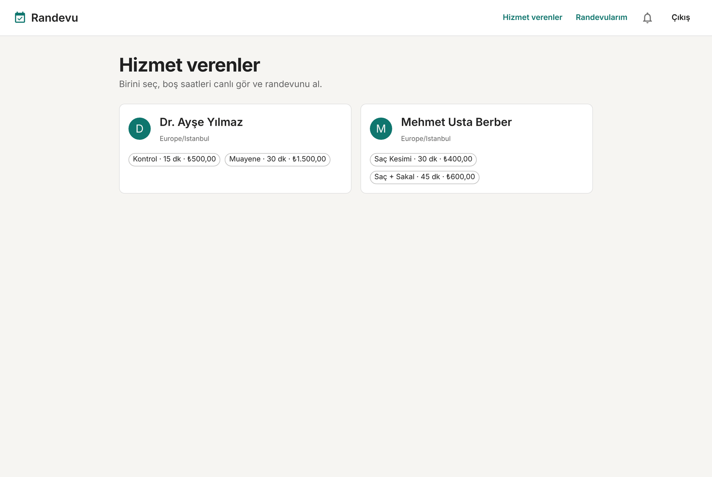

Giriş yapan kullanıcı tüm hizmet verenleri kartlar halinde görür. Her kartta sunulan hizmetler, süreleri ve fiyatları yer alır. Veri `GET /api/providers` uç noktasından **TanStack Query** ile çekilir ve önbelleğe alınır. Sayfalar arası geçişte tekrar yükleme beklenmez.

### 3. Canlı takvim ve saat seçimi


Randevu almanın ana ekranı. Önce hizmet seçilir (ör. 30 dakikalık *Muayene*), sonra gün. Sistem o günün slotlarını hizmet verenin çalışma saatlerine ve mevcut randevulara göre hesaplar:

- **Çerçeveli saatler** boş ve tıklanabilir
- **Üstü çizili saatler** dolu (ör. 09:30, 11:00, 14:30)
- Hesaplama sunucuda **Luxon** ile yapılır. Çalışma saatleri yerel saatte (`09:00 Europe/Istanbul`), randevular veritabanında UTC olarak tutulur. Yaz saati geçişleri otomatik doğru işlenir.
- Başlığın altındaki yeşil nokta **WebSocket** bağlantısının açık olduğunu gösterir. Bu takvimde biri randevu alır veya iptal ederse slotlar sayfa yenilemeden güncellenir.

### 4. Randevuyu onaylama

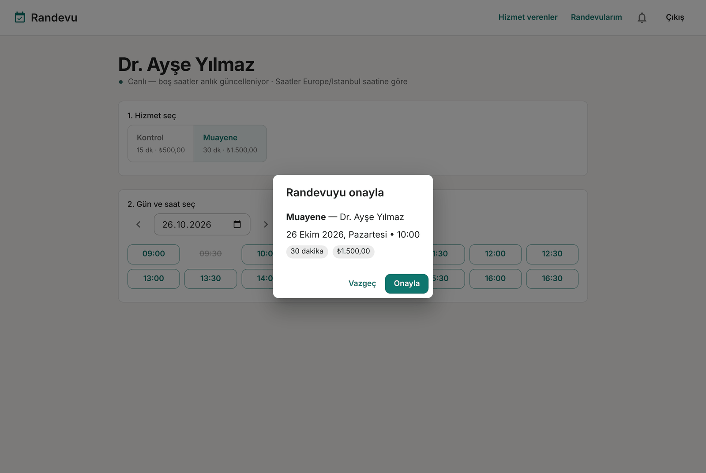

Bir saate tıklanınca özet penceresi açılır: hizmet, hizmet veren, tarih, süre ve ücret. *Onayla* ile `POST /api/bookings` isteği gider. Sunucu çifte rezervasyonu önlemek için bir **PostgreSQL advisory lock** alır ve slotu kendi tarafında yeniden doğrular. İki kişi aynı saate aynı anda tıklarsa ikincisine *"Bu saat az önce doldu"* uyarısı gösterilir ve slotlar tazelenir.

### 5. Randevularım ve anlık onay bildirimi

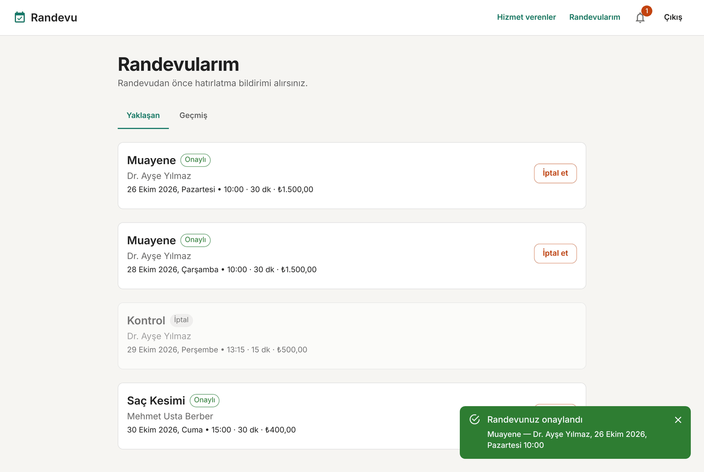

Onaydan sonra müşteri *Randevularım* sayfasına yönlendirilir. Sağ altta **SSE** ile gelen *"Randevunuz onaylandı"* bildirimi belirir. Liste *Yaklaşan* ve *Geçmiş* sekmelerine ayrılır. İptal edilen randevular soluk görünür. *İptal et* düğmesi randevuyu iptal eder, karşı tarafa bildirim gönderir ve BullMQ'daki hatırlatma işini kuyruktan siler.

### 6. Hizmet verenin ekranı: gerçek zamanlı güncelleme

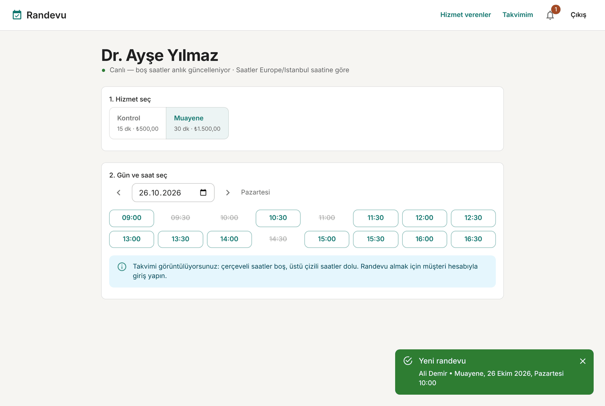

Uygulamanın en önemli özelliği bu ekranda görünüyor. Bu görüntü, müşteri randevuyu onayladığı anda **doktorun ekranından** alındı. Doktor hiçbir şeye tıklamadan iki şey oldu:

1. **10:00 slotu anında doldu** (üstü çizili). Sunucu Redis'e `slots:<providerId>` olayını yayınladı, WebSocket bu takvime bakan herkese haber verdi, TanStack Query sadece o günün verisini yeniden çekti.
2. **"Yeni randevu" bildirimi geldi.** Sunucu Redis'e `user:<doktorId>` olayını yayınladı, SSE bunu doktorun tarayıcısına iletti. Zildeki kırmızı rozet okunmamış bildirim sayısını gösterir.

Hizmet veren takvimi yalnızca görüntüler, kendi adına randevu alamaz.

### 7. Bildirim merkezi

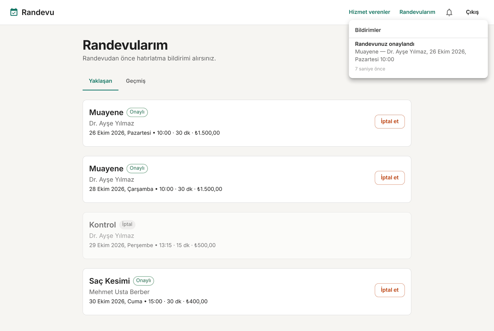

Zil ikonuna tıklanınca oturum boyunca gelen tüm bildirimler listelenir: onaylar, iptaller ve hatırlatmalar. Her bildirimin ne kadar önce geldiği gösterilir (ör. *"5 dakika önce"*). Zil gri görünüyorsa SSE bağlantısı kopmuştur. Tarayıcı birkaç saniye içinde otomatik yeniden bağlanır.

Hatırlatmalar da bu kanaldan gelir: randevudan belirlenen süre önce (varsayılan 60 dakika) **BullMQ worker'ı** gecikmeli işi çalıştırır ve müşteriye *"Randevu hatırlatması"* bildirimi gönderir.

### 8. Hizmet verenin takvimi

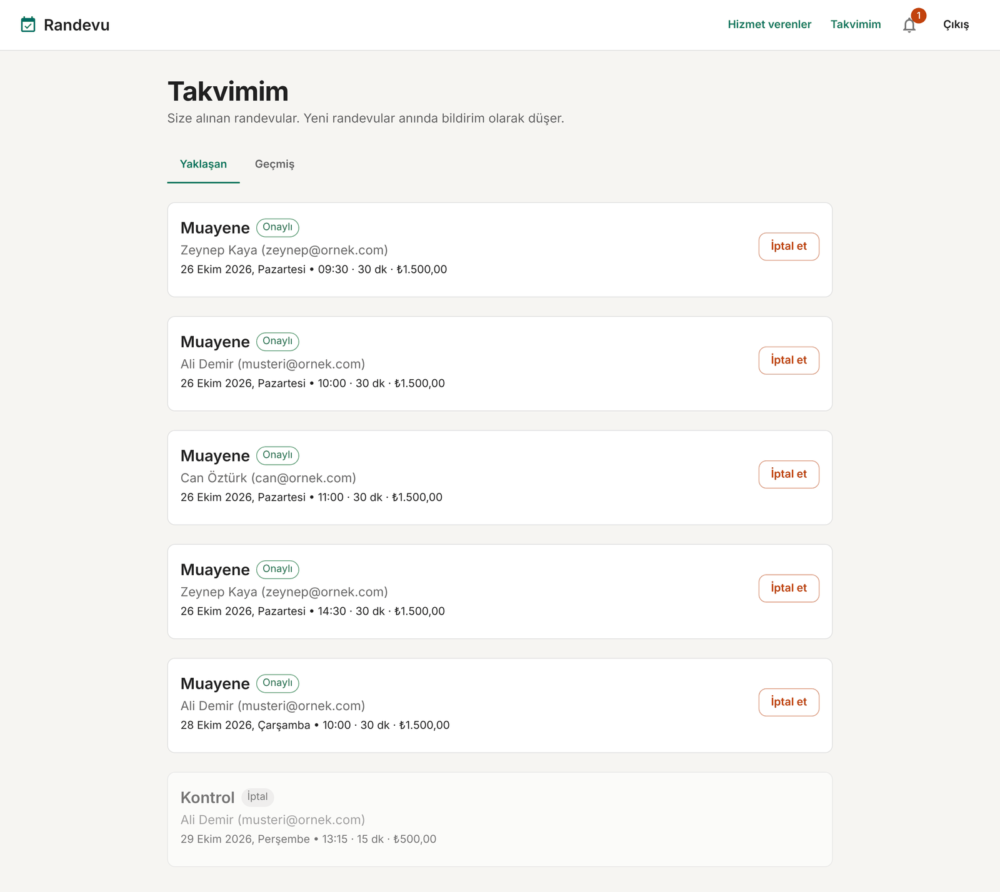

Hizmet veren hesabıyla *Takvimim* sayfası müşteri adı ve e-postasıyla birlikte kendisine alınan tüm randevuları gösterir. Aynı `GET /api/bookings/me` uç noktası kullanılır. Sunucu JWT'deki role göre müşteriye kendi randevularını, hizmet verene kendisine alınanları döner. Hizmet veren de randevu iptal edebilir. Bu durumda bildirim müşteriye gider.

### 9. Mobil görünüm

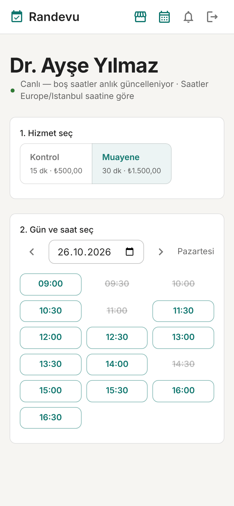

Arayüz **MUI**'nin duyarlı (responsive) yapısıyla telefonda da çalışır. Küçük ekranda üst menü metin yerine ikonlara dönüşür, saat butonları üç sütuna iner, kartlar tam genişliğe yayılır.

> Ekran görüntüleri örnek verilerle alınmıştır. Kendi kurulumunda `npm run db:seed` benzer demo hesapları ve hizmetleri oluşturur.

## 🧩 Hangi teknoloji nerede?

| Teknoloji | Projede ne işe yarıyor | Nerede bakmalı |
|---|---|---|
| **Node.js + TypeScript** | Tüm backend, tip güvenli | `apps/api/src` |
| **Express** | REST API sunucusu, route'lar | `apps/api/src/app.ts`, `modules/*` |
| **Joi** | İstek ve ortam değişkeni doğrulama | `middleware/validate.ts`, `config.ts` |
| **REST API** | `/api/auth`, `/api/providers`, `/api/bookings` | `modules/*/*.routes.ts` |
| **SSE** | Kişisel bildirim akışı (sunucu → tarayıcı) | `realtime/sse.ts`, web: `NotificationsContext.tsx` |
| **WebSocket (ws)** | Canlı takvim, çift yönlü abonelik | `realtime/ws.ts`, web: `useSlotsSocket.ts` |
| **PostgreSQL** | Kullanıcılar, hizmetler, randevular | `docker-compose.yml` |
| **Prisma** | ORM, şema ve migration | `apps/api/prisma/schema.prisma` |
| **Redis** | Pub/Sub (gerçek zamanlı olaylar) + BullMQ altyapısı | `lib/redis.ts`, `realtime/events.ts` |
| **BullMQ** | Gecikmeli hatırlatma işleri | `queues/reminders.ts`, `worker.ts` |
| **Luxon** | Yerel saat ↔ UTC dönüşümü, slot hesaplama | `services/availability.ts` |
| **React + Vite** | Arayüz ve geliştirme sunucusu | `apps/web` |
| **MUI** | Arayüz bileşenleri | `apps/web/src/theme.ts` |
| **TanStack Query** | Sunucu verisi, önbellek, yeniden çekme | `pages/*` |
| **React Router** | Sayfa yönlendirme, korumalı rotalar | `App.tsx` |
| **React Hook Form** | Giriş/kayıt formları | `LoginPage.tsx`, `RegisterPage.tsx` |
| **JWT** | Kimlik doğrulama | `lib/jwt.ts`, `middleware/auth.ts` |
| **PM2** | Üretimde süreç yönetimi (cluster + worker) | `deploy/ecosystem.config.cjs` |
| **Nginx** | Ters proxy, statik dosyalar, SSE/WS ayarları | `deploy/nginx.conf` |

## 🏗️ Mimari

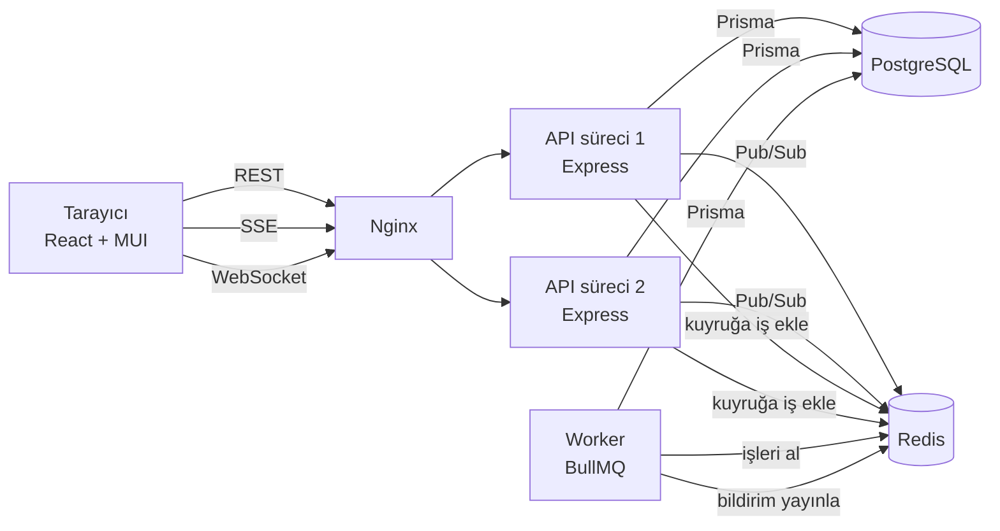

**Bir rezervasyonun yolculuğu:**

1. Müşteri slota tıklar → `POST /api/bookings`
2. API, Joi ile isteği doğrular, transaction içinde kilit alıp slotu **sunucuda yeniden hesaplar**, randevuyu kaydeder
3. İşlem bitince: BullMQ'ya "1 saat önce hatırlat" işi eklenir, Redis'e iki olay yayınlanır
4. `slots:<providerId>` olayı → WebSocket ile o takvime bakan herkese "yenile" mesajı gider
5. `user:<id>` olayı → SSE ile müşteriye "onaylandı", hizmet verene "yeni randevu" bildirimi gider
6. Zamanı gelince worker işi alır ve müşteriye hatırlatma bildirimi gönderir

## 🚀 Kurulum

**Gereksinimler:** Node.js 20+, Docker (veya yerel PostgreSQL 14+ ve Redis 6+)

```bash
# 1. Bağımlılıklar (Prisma client'ı da otomatik üretir)
npm install

# 2. PostgreSQL ve Redis'i başlat
docker compose up -d

# 3. Ortam değişkenleri
cp apps/api/.env.example apps/api/.env

# 4. Veritabanı tablolarını oluştur ve demo veri ekle
npm run db:migrate      # ilk seferde migration adı sorarsa: init
npm run db:seed
```

Üç ayrı terminalde:

```bash
npm run dev:api       # http://localhost:4000
npm run dev:worker    # hatırlatma işçisi
npm run dev:web       # http://localhost:5173
```

### Demo hesaplar

Hepsinin şifresi: `sifre123`

| Rol | E-posta |
|---|---|
| Müşteri | `musteri@ornek.com` |
| Hizmet veren | `doktor@ornek.com` |
| Hizmet veren | `berber@ornek.com` |

### 🔴 Gerçek zamanlı özellikleri test et

1. Bir tarayıcıda **müşteri**, gizli pencerede **doktor** hesabıyla giriş yap
2. İki pencerede de *Dr. Ayşe Yılmaz* sayfasını aç
3. Müşteri bir saati alsın → doktorun ekranında o saat **anında** üstü çizili olur (WebSocket) ve sağ altta "Yeni randevu" bildirimi çıkar (SSE)
4. Hatırlatmayı hızlı görmek için `.env` içinde `REMINDER_MINUTES_BEFORE=600` yap ve önümüzdeki 10 saat içine randevu al. Worker hemen bildirimi gönderir.

## 📁 Proje yapısı

```
randevu-sistemi/
├── apps/
│   ├── api/                      # Backend
│   │   ├── prisma/
│   │   │   ├── schema.prisma     # Veritabanı şeması
│   │   │   └── seed.ts           # Demo veri
│   │   └── src/
│   │       ├── config.ts         # Joi ile env doğrulama
│   │       ├── app.ts            # Express uygulaması
│   │       ├── server.ts         # HTTP + WebSocket sunucusu
│   │       ├── worker.ts         # BullMQ worker (ayrı süreç)
│   │       ├── lib/              # prisma, redis, jwt, hata sınıfları
│   │       ├── middleware/       # auth, validate, errorHandler
│   │       ├── modules/          # auth, providers, provider-admin, bookings
│   │       ├── queues/           # BullMQ kuyrukları
│   │       ├── realtime/         # events (Pub/Sub), sse, ws
│   │       └── services/         # availability (Luxon slot hesaplama)
│   └── web/                      # Frontend
│       └── src/
│           ├── api/              # REST istemcisi ve tipler
│           ├── auth/             # AuthContext (JWT)
│           ├── realtime/         # SSE context, WebSocket hook
│           ├── components/       # Layout, ProtectedRoute
│           └── pages/            # Giriş, kayıt, liste, takvim, randevularım
├── docs/screenshots/            # README görselleri
├── deploy/
│   ├── ecosystem.config.cjs      # PM2
│   └── nginx.conf                # Nginx
├── .github/workflows/ci.yml      # GitHub Actions: typecheck + build
└── docker-compose.yml
```

## 🔌 API uç noktaları

| Metot | Yol | Yetki | Açıklama |
|---|---|---|---|
| POST | `/api/auth/register` | — | Kayıt |
| POST | `/api/auth/login` | — | Giriş, JWT döner |
| GET | `/api/auth/me` | Giriş | Oturumdaki kullanıcı |
| GET | `/api/providers` | — | Hizmet verenler ve hizmetleri |
| GET | `/api/providers/:id` | — | Detay + çalışma saatleri |
| GET | `/api/providers/:id/availability?serviceId=&date=` | — | O günün slotları |
| POST | `/api/provider/services` | Hizmet veren | Hizmet ekle |
| PUT | `/api/provider/working-hours` | Hizmet veren | Haftalık programı güncelle |
| POST | `/api/bookings` | Müşteri | Randevu al |
| GET | `/api/bookings/me?scope=upcoming\|past` | Giriş | Randevularım / takvimim |
| POST | `/api/bookings/:id/cancel` | Taraflardan biri | İptal |
| GET | `/api/notifications/stream?token=` | Giriş | SSE bildirim akışı |
| WS | `/ws` | — | `{"type":"subscribe","providerId":"..."}` |

## 🌐 Üretime alma (Ubuntu sunucu)

```bash
git clone <repo> /var/www/randevu-sistemi && cd /var/www/randevu-sistemi
npm install
cp apps/api/.env.example apps/api/.env   # JWT_SECRET, DATABASE_URL, CORS_ORIGIN'i düzenle
npm run db:deploy -w apps/api            # migration'ları uygula
npm run build

npm i -g pm2
pm2 start deploy/ecosystem.config.cjs
pm2 save && pm2 startup

sudo cp deploy/nginx.conf /etc/nginx/sites-available/randevu
sudo ln -s /etc/nginx/sites-available/randevu /etc/nginx/sites-enabled/
sudo nginx -t && sudo systemctl reload nginx
```

## 🗺️ Yol haritası: 2. aşama

İlk aşama tek bir backend ile çalışıyor. İkinci aşamada sistemi servislere bölüp listedeki ileri seviye araçları ekleyeceğiz. Her biri projede **gerçek bir sorunu** çözecek:

| Teknoloji | Çözeceği sorun | Plan |
|---|---|---|
| **Fastify** | Yüksek trafikli okuma uçları | Müsaitlik sorgularını ayrı, hızlı bir `availability-service`'e taşı (Fastify'ın şema doğrulaması ve performansı) |
| **Kafka** | Olayların kalıcı kaydı ve analizi | `booking.created`, `booking.cancelled` olaylarını Kafka'ya yaz. Raporlama/analitik servisi bunları geriye dönük okuyabilsin |
| **NATS** | Servisler arası hızlı iletişim | Redis Pub/Sub yerine servisler arası anlık mesajlaşma (slot değişti, bildirim gönder) |
| **Temporal** | Çok adımlı, hata toleranslı akışlar | "Rezervasyon → ödeme → onay → hatırlatma → no-show kontrolü" iş akışı. Ödeme başarısızsa slotu otomatik serbest bırak |
| **OPA** | Karmaşık yetki kuralları | "Hizmet veren sadece kendi randevusunu iptal edebilir", "randevuya 2 saatten az kala müşteri iptal edemez" gibi kuralları Rego politikalarına taşı |

Diğer fikirler: e-posta gönderimi (Nodemailer), hizmet veren paneli (çalışma saatlerini arayüzden düzenleme), testler (Vitest + Supertest), Docker ile tam paketleme.

## 📤 GitHub'a yükleme

```bash
cd randevu-sistemi
git init
git add .
git commit -m "İlk sürüm: randevu sistemi"
git branch -M main
git remote add origin https://github.com/<kullanici-adin>/randevu-sistemi.git
git push -u origin main
```

GitHub'da önce boş bir repo oluştur (README eklemeden), sonra yukarıdaki komutları çalıştır. Push sonrası **Actions** sekmesinde CI otomatik çalışır.

## 📄 Lisans

MIT
